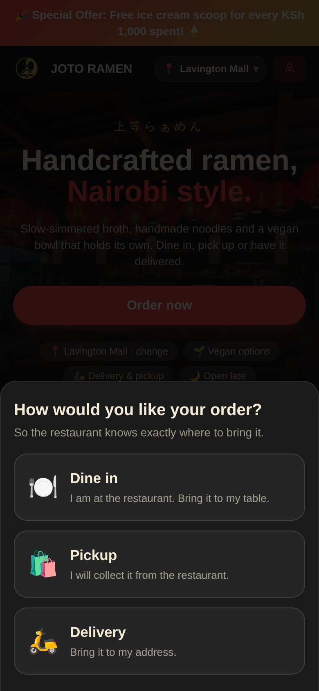
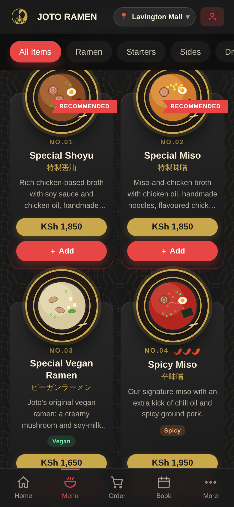
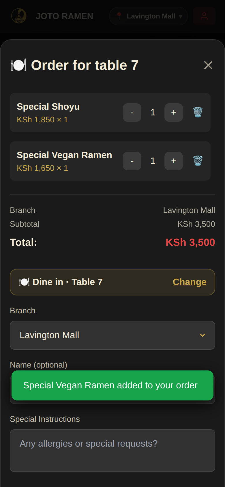
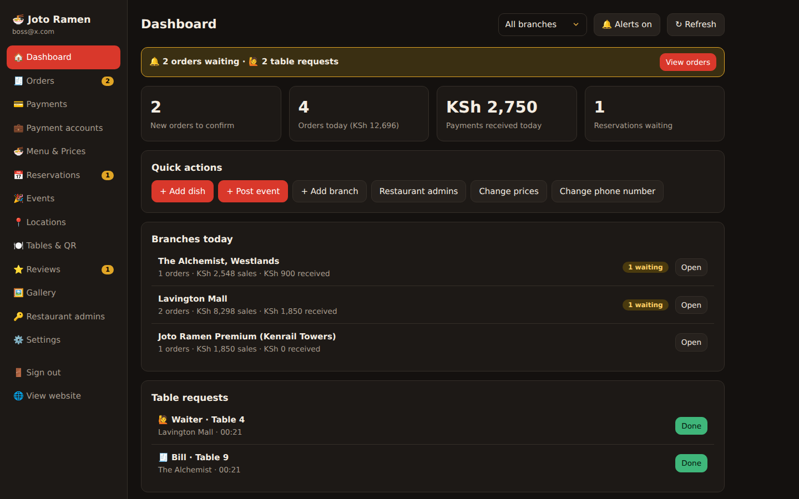

# Joto Ramen website

Ordering website for the three Joto Ramen restaurants (The Alchemist, Lavington Mall and Kenrail Towers), with an admin area for the owner and for each restaurant.

Customers choose a restaurant, then choose dine in (with a table number), pickup or delivery, order, and pay with M-Pesa. Each restaurant sees only its own orders.

   

## What is in the project

- `public/` the website (plain HTML, CSS and JavaScript, no build step except the stylesheet)
  - `index.html`, `script.js` the customer site
  - `admin.html`, `admin.js` the admin area
  - `images/` every picture used by the site (see Images below)
- `supabase/` the database files and the server functions
- `scripts/build.js` sets the Supabase keys during a Vercel deploy
- `docs/restaurant-info.md` details about the restaurants that still need confirming

## Set up

1. Create a project at supabase.com.
2. In the Supabase SQL editor, run the files in `supabase/` in this order. They are safe to run again.
   `schema.sql`, `locations-events.sql`, `staff-and-orders.sql`, `mpesa.sql`, `multi-branch.sql`, `managers.sql`, `simplify.sql`, `payments-qr.sql`, `uploads.sql`, `payment-accounts.sql`, `menu-draft-items.sql`, `local-images.sql`
3. Open `public/config.js` and put in your Supabase project URL and the anon (public) key. Never use the service_role key there.
4. Deploy the functions in `supabase/functions/` (Supabase dashboard, Edge Functions):
   `mpesa-stk-push`, `mpesa-callback`, `staff-admin`, `payment-settings`.
   Turn "Verify JWT" off for `mpesa-callback` only.
5. Make yourself the owner. Sign up on the site, then run this in the SQL editor with your email:
   `update public.profiles set is_admin = true where id = (select id from auth.users where email = 'you@example.com');`
6. Put the project on GitHub and import it in Vercel. In Vercel you can add `SUPABASE_URL` and `SUPABASE_ANON_KEY` as environment variables instead of editing `config.js`.
7. In Supabase, Authentication, URL Configuration: set the Site URL to your Vercel address.
8. Sign in at `/admin.html`. Under "Restaurant admins" create one login per restaurant.

## Logins

- Owner: sees all restaurants, changes prices and settings, creates the restaurant admin logins.
- Restaurant admin: sees only their own restaurant. They confirm orders, record payments, print order slips, turn dishes on or off for their restaurant, post events and photos, and edit its hours.
- Customers do not need an account.

## Images

All pictures are saved in `public/images/`:

- `brand/` logo, app icons and the main photo
- `menu/` one picture per type of dish
- `gallery/` photos of the restaurant

The menu pictures are drawings that stand in until you have photos of the real dishes. To use a real photo, open Admin, Menu & Prices and tap the camera button on a dish. Photos up to 50 MB can be uploaded and are resized automatically. They are stored in your Supabase storage.

## M-Pesa

Right now every restaurant uses the shared demo (sandbox) account, so no real money moves. Add these in Supabase, Edge Functions, Secrets:

`MPESA_ENV` (sandbox), `MPESA_CONSUMER_KEY`, `MPESA_CONSUMER_SECRET`, `MPESA_SHORTCODE`, `MPESA_PASSKEY`, `MPESA_CALLBACK_SECRET` (any long random text), and optionally `MPESA_TXN_TYPE` and `MPESA_PARTY_B`.

Then turn on "Let customers pay with M-Pesa" in Admin, Settings.

To take real money, each restaurant needs its own paybill or till and Safaricom's Go Live approval. When that is ready, open Admin, Payment accounts, enter the number and the Daraja keys for that restaurant, save, and switch Live payments on. The switch stays locked until everything is filled in. The keys are kept on the server and are never shown again.

Customers can also pay by scanning the restaurant's M-Pesa QR code. Upload the QR image in Admin, Locations, Edit. The admin confirms these payments by hand.

## Settings worth knowing

- Cancel time: customers can cancel for 80 seconds after ordering. Change it in Admin, Settings.
- Alerts: a new order gives one short beep. Use the Alerts button to turn the sound off.
- Table QR codes: Admin, Tables & QR. Each code opens the menu for that restaurant and table.

## Stylesheet

`public/tailwind.css` is built from the classes used in the pages. After changing classes, run `npm install` once and then `npm run build:css`.

## Run it on your computer

`npx serve public -l 5501`
