# Joto Ramen

One website and one database for all three Joto Ramen restaurants. Customers pick their restaurant, then how they want to be served (dine in, pickup or delivery). Each restaurant's admin sees only that restaurant's orders and decides what happens next. Static site (HTML + vanilla JS + a built Tailwind stylesheet) on Vercel, with Supabase for the database, logins, image storage and three small server functions.

| 1. Choose your restaurant | 2. Dine in, pickup or delivery | 3. Order |
|---|---|---|
| 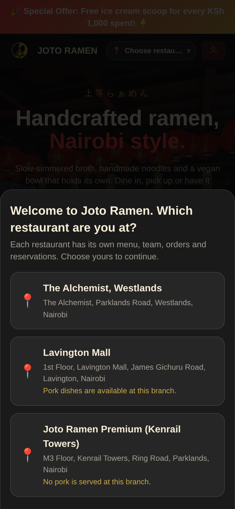 | 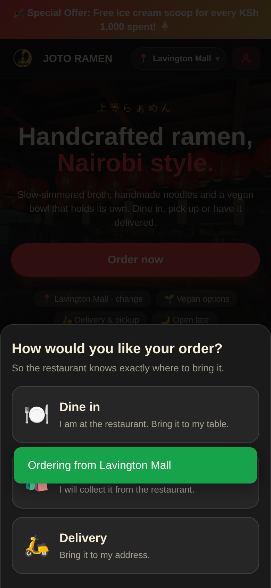 | 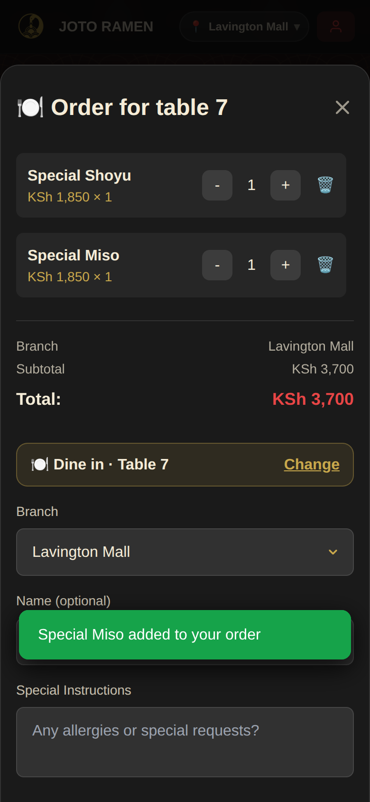 |

| 4. Floating "My orders" button | 5. Pay any time: M-Pesa prompt or QR |
|---|---|
| 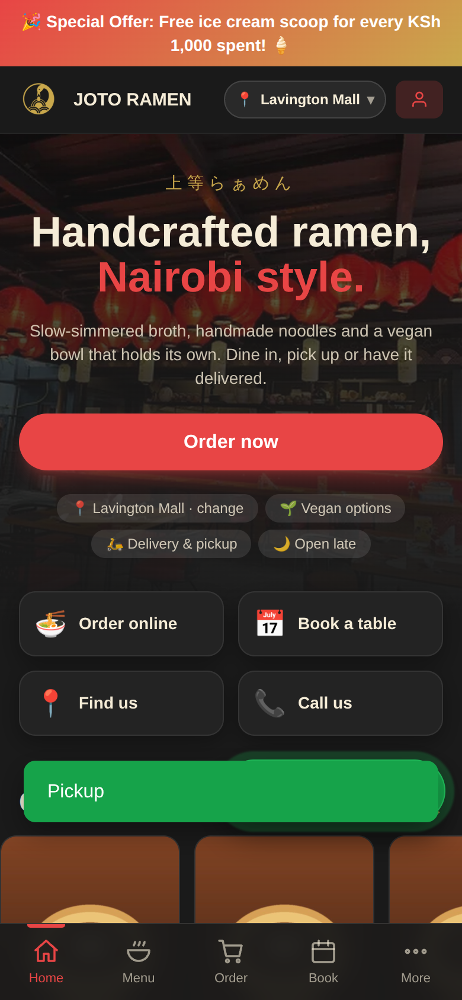 | 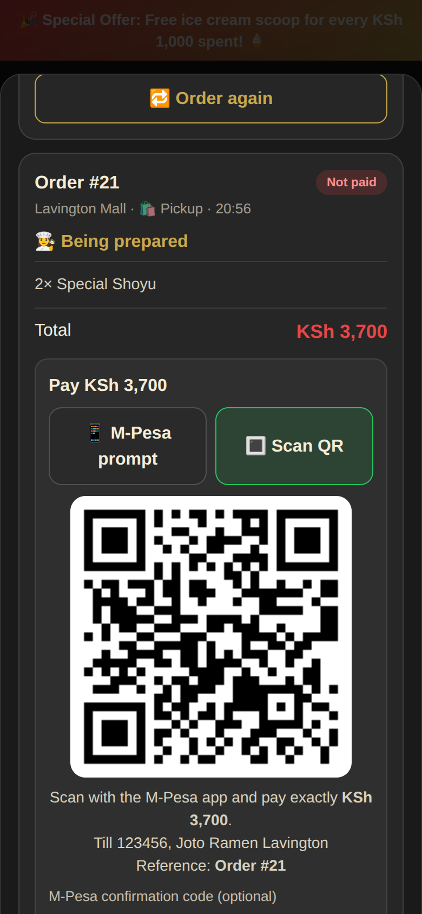 |

| Home | Menu | Table QR code |
|---|---|---|
|  | 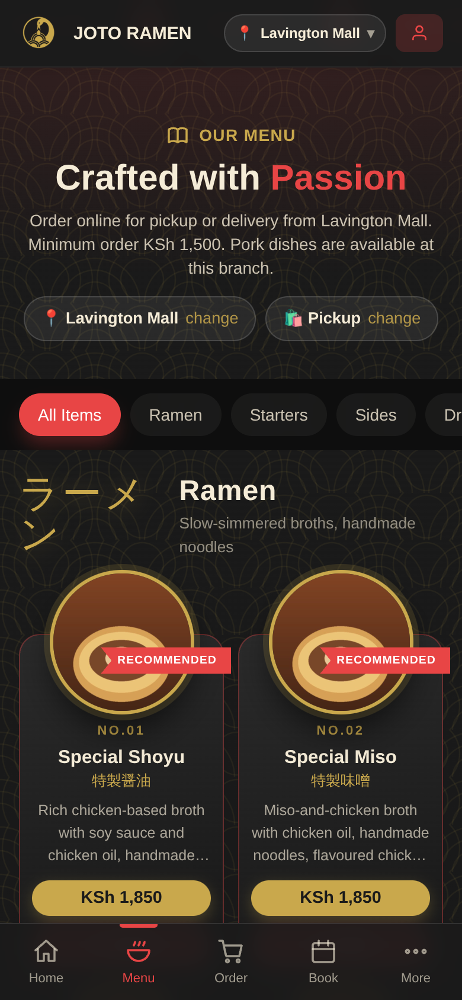 | 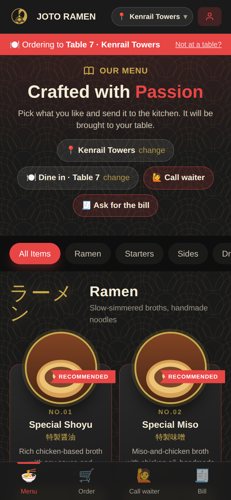 |

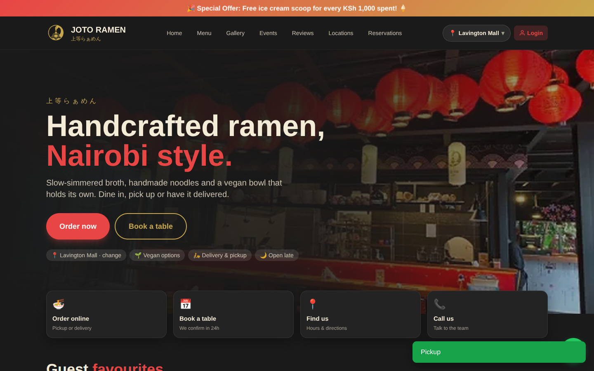
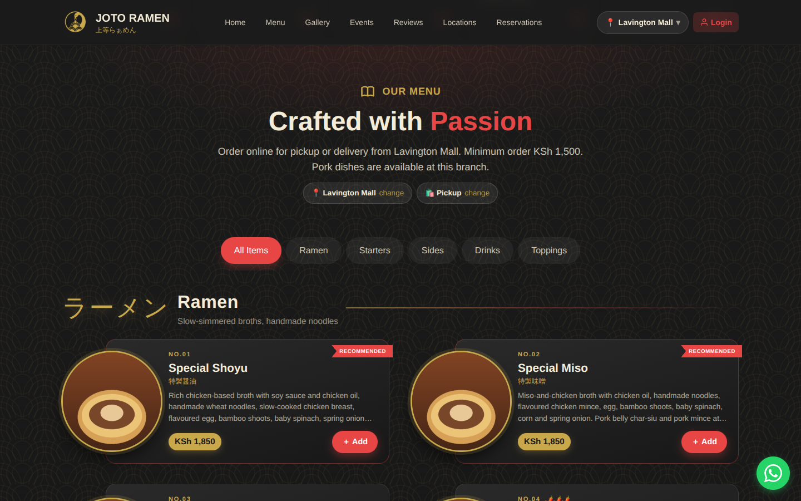

### Admin

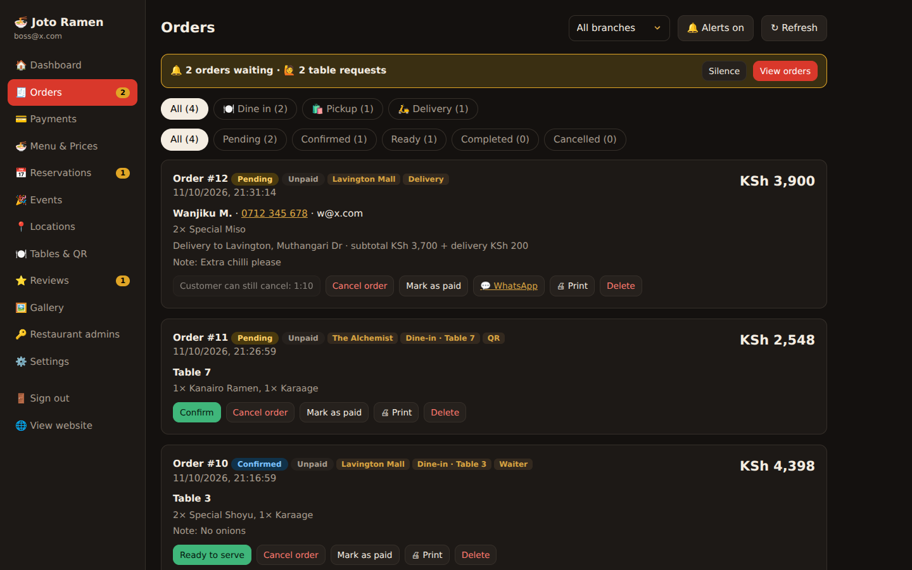
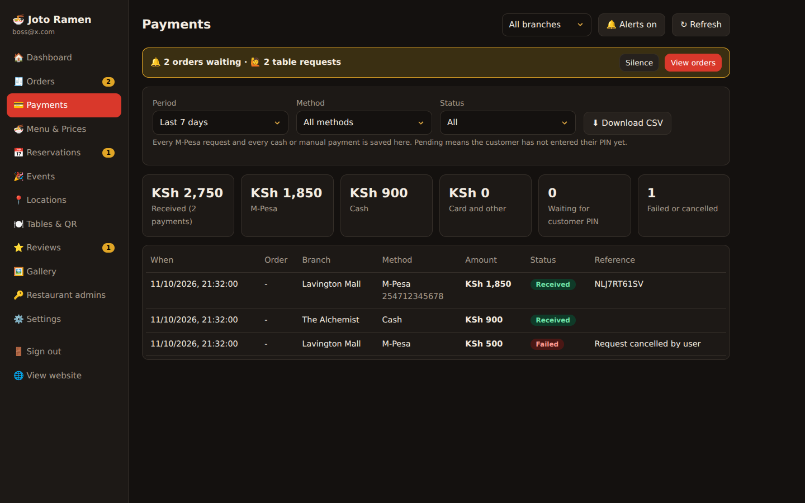
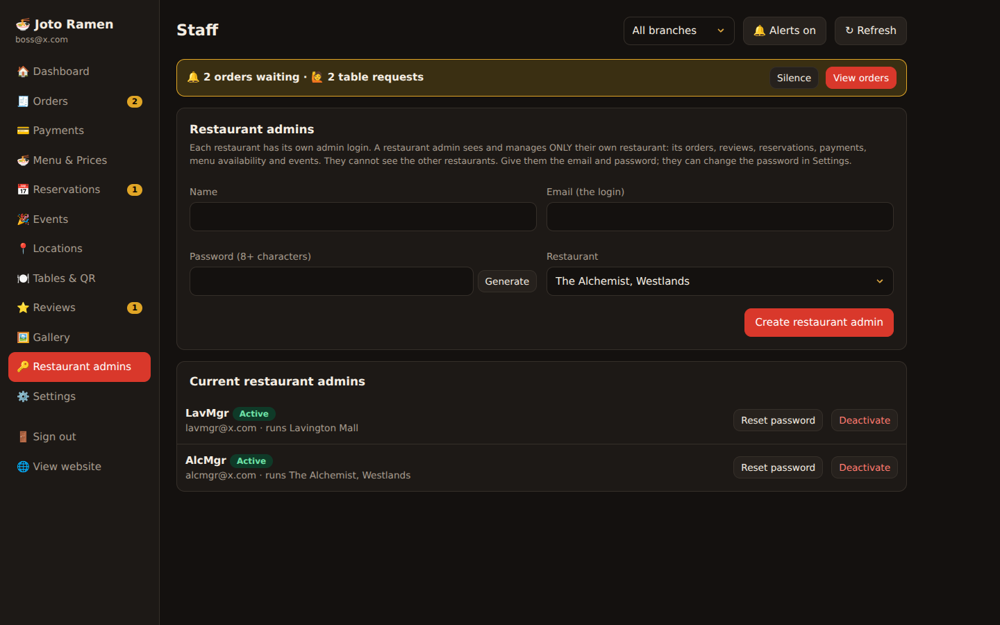
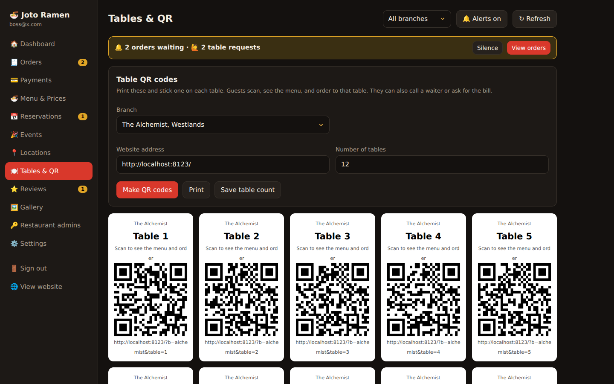

> Screenshots use sample data and a stand-in food photo. The live site shows real photos.

## How an order works
1. **Restaurant:** the site asks which restaurant you are at (Alchemist, Lavington Mall, Kenrail Towers). The menu, reviews, events, photos and prices shown follow that choice.
2. **How you are served:** *Dine in* (type the number on your table, or scan the table's QR code and this step is skipped), *Pickup* or *Delivery*. The order form then only asks for what that choice needs: dine in needs nothing but an optional name, pickup needs name, phone and email, delivery also needs the address.
3. **Order:** the order goes to that restaurant's admin screen, tagged **Dine-in · Table 7**, **Pickup** or **Delivery**. The admin confirms it, marks it ready, then served or completed. The customer sees the live status on their phone.
4. **Cancel:** customers can cancel for **1 minute 20 seconds** (a setting: Admin > Settings > Customer cancel window, 15 to 300 seconds). The kitchen can only confirm after that, so a cancelled order is never cooked.
5. **My orders and pay:** after ordering, a floating **My orders** button stays on screen (it turns green and shows the amount while something is unpaid). Tapping it lists the orders from the last 24 hours with what was bought, live status and payment, so customers can pay whenever they like:
   - **M-Pesa prompt:** an M-Pesa PIN request is sent to their phone (needs the Daraja setup below); or
   - **Scan QR:** the restaurant's own M-Pesa till or paybill QR is shown with the exact amount and the order number as reference. The customer pays in the M-Pesa app, optionally types the confirmation code and taps *I have paid*. The restaurant admin sees *Customer says paid* with the code, checks the M-Pesa statement and taps **Payment received** (or **Not received**).
   - Or pay at the restaurant or on delivery. Past orders have **Order again**.

## Who can do what
| Role | Created by | Sees | Can do |
|---|---|---|---|
| **Owner** (`is_admin`) | SQL (setup step 4) | All restaurants | Everything: menu and prices, settings, M-Pesa switch, every restaurant, creates the restaurant admins |
| **Restaurant admin** (`is_manager`) | The owner (Admin > Restaurant admins) | Only their own restaurant: orders, reviews, reservations, payments, table requests | Confirm and serve orders, close tables, record payments, print order slips, switch dishes on or off for their restaurant, post events and photos for it, edit its hours and table count |
| **Customer** | Signs up on the site (optional) | Their own orders | Order, cancel within 2 minutes, pay, review |

This is enforced by Row Level Security in the database (`supabase/managers.sql`), not just hidden on screen, so one restaurant's admin cannot read another restaurant's data even by calling the API directly. There is no waiter or staff app: the restaurant admin sits on the order screen (a phone, tablet or laptop at the counter) and decides.

## What is in the repo
```
public/
  index.html, script.js        customer site
  admin.html, admin.js         admin (owner and restaurant admins)
  alerts.js                    order chime, vibration, notifications
  menu.css, mobile.css, tailwind.css   styles (tailwind.css is built, see "Styles")
  privacy.html, terms.html, robots.txt, sitemap.xml, manifests, sw.js, icons, logo, hero
supabase/
  schema.sql, locations-events.sql, staff-and-orders.sql, mpesa.sql, multi-branch.sql, managers.sql, simplify.sql, payments-qr.sql, uploads.sql   run in this order
  menu-draft-items.sql, standin-images.sql                       extra dishes and temporary photos
  functions/mpesa-stk-push, mpesa-callback, staff-admin          Edge Functions
scripts/build.js               writes public/config.js from environment variables on Vercel
docs/restaurant-info.md        researched facts and what to confirm
```

## Setup
1. Supabase: run the nine SQL files in `supabase/` in the order above in the SQL editor (all safe to re-run).
2. Put the project URL and the **anon (public)** key in `public/config.js`, or set them in Vercel (below). Never use the service_role key.
3. Deploy the three Edge Functions in `supabase/functions/`. Keep JWT verification **on** for `mpesa-stk-push` and `staff-admin`, **off** for `mpesa-callback`.
4. Make yourself the owner: sign up on the site, then run
   `update public.profiles set is_admin = true where id = (select id from auth.users where email = 'you@example.com');`
5. Sign in on the website or at `/admin.html`. Admins are sent to the admin panel, and the account button in the website's top bar shows your email and opens the panel again.
6. Admin > Restaurant admins: create one login per restaurant and give each the email and password. They change the password in Settings.

### Connect Supabase to Vercel
`vercel.json` runs `scripts/build.js` on every deploy. In Vercel > Project > Settings > Environment Variables add `SUPABASE_URL` and `SUPABASE_ANON_KEY` (or install the official Supabase integration, which adds `NEXT_PUBLIC_SUPABASE_URL` and `NEXT_PUBLIC_SUPABASE_ANON_KEY`; both are understood). The build writes `public/config.js` from them. Without them, the committed `public/config.js` is used. In Supabase > Authentication > URL Configuration set the Site URL and redirect URL to your Vercel address.

### M-Pesa (Daraja)
In Supabase > Edge Functions > Secrets add:

| Secret | Value |
|---|---|
| `MPESA_ENV` | `sandbox` or `production` |
| `MPESA_CONSUMER_KEY`, `MPESA_CONSUMER_SECRET` | from your Daraja app |
| `MPESA_SHORTCODE`, `MPESA_PASSKEY` | shortcode and Lipa Na M-Pesa passkey |
| `MPESA_TXN_TYPE` | `CustomerPayBillOnline` (paybill) or `CustomerBuyGoodsOnline` (till) |
| `MPESA_PARTY_B` | the till number (Buy Goods only) |
| `MPESA_CALLBACK_SECRET` | any long random string you invent |

Then turn on Admin > Settings > "Let customers pay with M-Pesa". Test in sandbox first. Every attempt is saved in Admin > Payments (CSV download).

## Alerts are deliberately quiet
A new order, a payment to confirm or a table request makes **one short beep** (and one short buzz on a phone, plus one silent notification if the page is in the background). Nothing repeats and the page title does not flash. Use the Alerts button to turn the beep off. Tap the page once after opening it so the browser allows sound.

## Photos
Admins can upload photos up to **50 MB** (the Supabase free-plan maximum, set in `supabase/uploads.sql`). Big camera photos are scaled down in the browser before upload (longest side 2000 px), so the website stays fast. Each restaurant's M-Pesa payment QR image is uploaded under Admin > Locations > Edit.

## Day to day (restaurant admin)
- **Orders** is the home screen. New orders beep once and show in the alert bar. Filter by Dine in, Pickup or Delivery. Confirm, mark ready, then served or completed. Print a kitchen slip with 🖨 Print. WhatsApp the customer with one tap.
- **Dashboard > Open tables** lists tables with unpaid orders; Mark table paid closes them in one go.
- **Menu availability:** switch a dish off for your restaurant only. Prices stay with the owner.
- **Tables & QR:** print a QR code per table. It carries the restaurant and the table, so guests skip the questions.

## Styles
`public/tailwind.css` is built from the classes used in `index.html` and `script.js`. After changing Tailwind classes run `npm install` once, then `npm run build:css`, and commit the result.

## Local preview
`npx serve public -l 5501`
